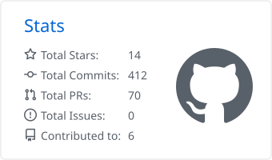
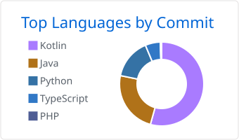

# Arnold Karambiri

**Software Developer · Machine Learning & Distributed Systems** 
IT Developer at Orange Burkina Faso · Licence (B.Sc.) in Computer Science, ESI

I build machine learning and distributed systems that can be trusted, and traced.
I care about evaluation as much as models, and about systems where every result can be checked back to its source.

**Open to research or professional positions** in machine learning and distributed systems.

## Research interests

- **Machine learning for decision support:** combining deep learning models with interpretable, domain-grounded indicators, and tracing each prediction back to the data that produced it.
- **Distributed and event-driven systems:** microservices, stream processing with Kafka Streams and BPMN workflow orchestration, with a focus on reliability and auditability.
- **Research software engineering:** reproducible data pipelines, containerized deployment and tooling that make results easier to verify and reuse.

## Selected projects

### [Financial Risk Early-Warning System](https://github.com/Arnold-Ka/risk-detector) · [live demo](https://risk-detector-two.vercel.app) · [write-up](https://arnold-dev.online/en/article/un-detecteur-de-risque-financier-dont-chaque-score-se-verifie)

Can financial distress at U.S. listed companies be flagged early from public data alone, and can each alert be justified?

- Parses SEC EDGAR filings and market prices, computes **ten established indicators** (Altman Z-score, Piotroski F-score, Beneish M-score, cash runway, late filings, insider sales…) and combines them into one risk level per fiscal year.
- A **PyTorch LSTM explained with SHAP** estimates a distress probability alongside the score, kept out of it.
- **Point-in-time backtest** on 547 bankruptcies (2015–2025) against 328 healthy S&P 500 companies: **64.9 % flagged 6 months ahead**, 9.3 % false alerts per year, with an out-of-sample check on 2021–2025.
- Every score links back to the filing that produced it.

`Python` `PyTorch` `SHAP` `FastAPI` `PostgreSQL`

### [Freelancia](https://github.com/Arnold-Ka/Freelancia-Backend) · [site](https://freelancia.arnold-dev.com)

How can freelance payments be made trustworthy in West Africa, where Mobile Money dominates and disputes are costly?

- Event-driven microservices around **Kafka** (gateway, users, missions, finance, notifications, chat, back-office).
- **Keycloak** for identity, **Camunda Zeebe** for BPMN workflows, escrow per milestone and **double-entry ledger** accounting.
- Append-only audit log and Prometheus / Grafana monitoring: every money movement is traceable and observable.

`Kotlin` `Spring Boot` `Kafka` `Keycloak` `Zeebe` `PostgreSQL` `Redis` `Docker`

### Earlier projects

| Project | What it does | Stack |
|---|---|---|
| [EsiOverflow](https://github.com/Arnold-Ka/EsiOverflow) | Q&A platform for students | Django · React · PostgreSQL |
| [eCEP](https://github.com/Arnold-Ka/eCEP) | Exam preparation for primary school pupils | Django · Flutter |
| [FasoMétéo](https://github.com/Arnold-Ka/FasoMeteo) | Weather advice for farmers, delivered by SMS | Django · Flutter · SMS API |

## Experience

- **IT Developer**, Orange Burkina Faso · Mar. 2026 – present 
  Spring Boot and Spring Cloud services in an environment based on Kafka Streams, Camunda BPM, Docker and Kubernetes.
- **Full-Stack Developer (internship)**, Yandoama Consulting · Jul. 2025 – Feb. 2026 
  Web and mobile development with Spring Boot, Angular, Flutter and PostgreSQL.

## Toolkit

| | |
|---|---|
| **Languages** | Python · Java · Kotlin · TypeScript |
| **Machine learning & data** | PyTorch · SHAP · PostgreSQL · MongoDB · Redis |
| **Distributed systems** | Spring Boot · Spring Cloud · Kafka Streams · Camunda · Keycloak |
| **Infrastructure** | Docker · Kubernetes · GitHub Actions · Prometheus · Grafana |
| **Web & mobile** | Next.js · React · Angular · Flutter |

## Activity

<!-- Cards generated every night in this profile repository by .github/workflows/profile-cards.yml
     (github-profile-summary-cards): no external server that can go down. -->

  <picture>
    <source media="(prefers-color-scheme: dark)" srcset="./profile-summary-card-output/github_dark/3-stats.svg" />
    
  </picture>
  <picture>
    <source media="(prefers-color-scheme: dark)" srcset="./profile-summary-card-output/github_dark/2-most-commit-language.svg" />
    
  </picture>

---

  I work in French and English. 
  <a href="https://arnold-dev.com">Portfolio</a> · <a href="https://arnold-dev.online/en/">Blog</a> · <a href="mailto:arnoldkarambiri293@gmail.com">Email</a> · <a href="https://linkedin.com/in/hackers01">LinkedIn</a>

