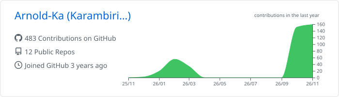
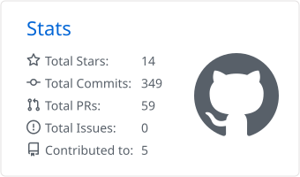
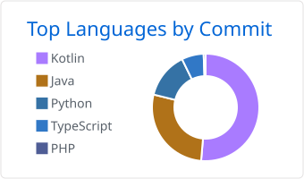

# Arnold Karambiri

**Full-stack developer · Licence (Bachelor's) in Computer Science, ESI Burkina Faso**

## About

- Full-stack developer, **Licence (Bachelor's) in Computer Science** from the **École Supérieure d'Informatique (ESI)**, Burkina Faso
- I design backends that hold up in production: modular monoliths, event-driven flows, money that never moves twice
- I care about the people at the other end: slow networks, phone-first users, Mobile Money instead of cards

## Now

Building **Freelancia**, a freelance marketplace for West Africa:

- escrow per milestone and a double-entry ledger, SYSCOHADA-ready accounting
- Mobile Money payouts, phone + SMS sign-in, amounts in F CFA
- verified identities and companies (IFU / RCCM), double-blind reviews, chat with contact masking

`Kotlin` `Spring Boot 4` `Next.js` `Angular` `PostgreSQL` `Kafka` `Redis` `Keycloak` `Zeebe` `Docker` `GitHub Actions`

## Projects

| Project | What it does | Stack |
|---|---|---|
| [**Freelancia**](https://github.com/Arnold-Ka/freelancia) | Freelance marketplace for West Africa: escrow, Mobile Money, verified profiles | Kotlin · Spring Boot · Next.js · Angular |
| [**EsiOverflow**](https://github.com/Arnold-Ka/EsiOverflow) | Q&A platform for students: Stack Overflow meets group chat | Django · React · PostgreSQL |
| [**eCEP**](https://github.com/Arnold-Ka/eCEP) | Gamified exam prep for primary school pupils | Django · Flutter · REST |
| [**FasoMétéo**](https://github.com/Arnold-Ka/FasoMeteo) | Weather advice for farmers, delivered by SMS | Django · Flutter · SMS API |

## Stack

  
   
  

## Activity

<!-- Cards generated every night in this profile repository by .github/workflows/profile-cards.yml
     (github-profile-summary-cards): no external server that can go down. -->

  <picture>
    <source media="(prefers-color-scheme: dark)" srcset="./profile-summary-card-output/github_dark/0-profile-details.svg" />
    
  </picture>

  <picture>
    <source media="(prefers-color-scheme: dark)" srcset="./profile-summary-card-output/github_dark/3-stats.svg" />
    
  </picture>
  <picture>
    <source media="(prefers-color-scheme: dark)" srcset="./profile-summary-card-output/github_dark/2-most-commit-language.svg" />
    
  </picture>

  

## Learning

System design · Distributed systems and observability · Cloud and Kubernetes · Application security

---

  Open to opportunities and collaborations on <b>EdTech</b>, <b>fintech for Africa</b> and <b>open source</b>. 
  <a href="mailto:arnoldkarambiri293@gmail.com">Write to me</a> · <a href="https://linkedin.com/in/hackers01">LinkedIn</a>

